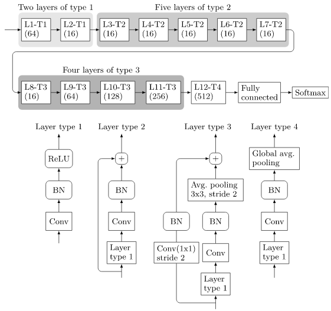

# Deep Residual Network for Steganalysis of Digital Images (SRNet model) Pytorch Implementation:

## This project's paper-aligned reproduction

The original third-party `train.py` and `test.py` are preserved under `legacy/`.
The root entry points now use `paper_train.py` and `paper_eval.py`.

Training now defaults to BF16 automatic mixed precision, `channels_last`,
and cuDNN benchmarking on the RTX 4070 Ti SUPER. Model parameters and optimizer
state remain FP32; validation and testing use the checkpoint's recorded
precision. A `tqdm` progress bar shows completed steps, ETA, recent loss,
accuracy, and speed. To revert to the original numerical path, run
`python train.py --no-amp --no-channels-last --no-cudnn-benchmark`.
On this machine, a short synthetic 32-image benchmark measured about 4.9
steps/s in the original FP32 path and 9.8 steps/s with all three speed settings;
full training speed can differ due to image loading and validation.

The PyTorch model follows the official TensorFlow SRNet's 12 layers, 3x3
convolutions with bias 0.2, BatchNorm decay 0.9 / epsilon 0.001, and asymmetric
TensorFlow `SAME` average pooling at the four even-sized downsampling layers.
Convolution weights use the official truncated-normal variance scaling; the
output is two logits. Training uses 0..255 float image values, paired rotations
and flips, cross-entropy, convolution L2 coefficient 2e-4, the official
custom Adamax update without first-moment bias correction, and 16
cover/stego pairs per step, 500,000 steps, and a learning-rate drop at 400,000.

`paper_train.py` creates `../data/boss_split_seed_20261119.json` with 4,000
BOSSbase training pairs, 1,000 validation pairs, and 5,000 held-out test pairs;
all 10,000 BOWS2 pairs are used only for training. The original paper did not
publish the exact split indices, so this manifest freezes one reproducible
split rather than claiming the same individual images as the paper. Training
requires all 20,000 cover/stego pairs.

From the `srnet` conda environment in this directory:

```powershell
python train.py --smoke
python train.py
# If a run is interrupted after a checkpoint:
python train.py --resume
# After training finishes:
python test.py
```

Training writes `../results/run_config.json` with dataset split, environment,
and source hashes. Every 100 steps, `../results/train_history.csv` records
mean cross-entropy, L2 penalty, total loss, training accuracy, learning rate,
throughput, and peak GPU memory. Every 5,000 steps,
`../results/validation_history.csv` records validation loss, accuracy, false
alarm and miss rates, P_e, minimum P_e, AUC, confusion counts, and evaluation
time. Both histories are also available in TensorBoard:

```powershell
tensorboard --logdir ..\results\tensorboard
```

At each validation, PNG and SVG figures are updated in `../results/figures/`:
loss, accuracy/AUC, P_e, and training throughput. To regenerate figures from
the CSV files after an interrupted run, use `python paper_reporting.py`.
The training CSV contains 100-step averages rather than individual batches;
the validation metrics use the fixed BOSSbase validation subset. The held-out
BOSSbase test set is used only by `python test.py` after training.

The assigned acceptance limit is P_e <= 0.18184. The actual S-UNIWARD
training/testing cell at 0.4 bpp in the paper's Table II is P_e = 0.1023.
`evaluation.json` records both values and whether the assigned limit was met.

The model with the highest validation accuracy after the learning-rate drop is
saved as `../checkpoints/best_valid_final_100k.pt`. Evaluation writes
`../results/evaluation.json` with BOSSbase-only confusion matrices, paper-style
minimum test P_e, validation-threshold P_e, and ROC AUC. The test-optimal
threshold is reported explicitly because it is selected using test labels;
the validation-threshold confusion matrix is also provided.

This is a PyTorch translation of the official protocol, not a bit-identical
execution of the old TensorFlow graph. Different random draws, BatchNorm
implementation details, and CUDA kernels can affect the final result.

This is an unofficial implementation of paper: "Deep Residual Network for Steganalysis of Digital Images"
The model can be tested using the file test.py
The tensorflow code of the same can be found at: http://dde.binghamton.edu/download/feature_extractors/

The test accuracy reported in the paper is **89.77%**. My implementation achieved **89.43%** on S-Uniward 0.4bpp.

The model is trained and tested on Tesla V-100-DGX with 32GB GPU.


<table>
  <tr>
    <td align="center">SRNet architecture</td>
  </tr>
  <tr>
    <td valign="top"></td>
  </tr>
 </table>

 ### Datasets:
 You can find cover images here: [BOSSbase_1.01.zip](https://dde.binghamton.edu/download/ImageDB/BOSSbase_1.01.zip)
 
Steganography algorithms here: [SUniward](https://dde.binghamton.edu/download/stego_algorithms/download/S-UNIWARD_linux_make_v10.tar.gz), [WOW](https://dde.binghamton.edu/download/stego_algorithms/download/WOW_linux_make_v10.tar.gz), and [MiPOD](https://dde.binghamton.edu/download/stego_algorithms/download/MiPOD_matlab.zip).

Create corresponding stego images for each cover image with steganography algorithm of your choice. 
Make sure to change random seed for each image to get random key dataset.
